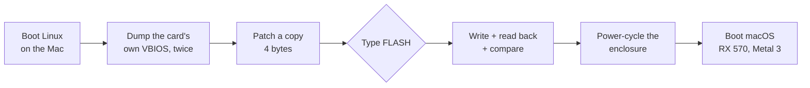

<div align="center">

# RX 580 2048SP → Mac eGPU

**Your $80 "RX 580" is lying about its name. Four bytes fix that.**

Get a Chinese-market RX 580 2048SP (8 GB) running as a fully native,<br>
Metal-accelerated, display-driving eGPU on an Intel Mac. No kexts. No OpenCore. No patched system files.


</div>

---

## TL;DR

| | Before | After |
|---|---|---|
| **macOS sees** | `Display` (unknown AMD device) | `AMD Radeon RX 570` |
| **PCI ID** | `1002:6FDF` | `1002:67DF` |
| **Metal** | none | Metal 3 |
| **VRAM** | n/a | 8 GB |
| **Monitor on the card** | kernel panic | 3440 × 1440 @ 160 Hz, 30-bit |
| **System mods needed** | SIP off, patched kernel collection | none |

The card is a real Polaris 20 chip with 8 GB of VRAM. It just reports a PCI
device ID (`6FDF`) that Apple's AMD drivers have never heard of. Flash its
VBIOS so it reports `67DF` and macOS treats it as the RX 570 it more or less is.

Everything else on the card stays byte-identical: clocks, voltages, fan curve,
memory timings. You are changing its name tag, not its personality.

---

## Contents

- [Is this you?](#is-this-you)
- [What we tested on](#what-we-tested-on)
- [How it works](#how-it-works)
- [The flash, step by step](#the-flash-step-by-step)
- [Verify it](#verify-it)
- [If it goes wrong](#if-it-goes-wrong)
- [What did not work](#what-did-not-work)
- [FAQ](#faq)
- [Credits](#credits)

---

## Is this you?

You bought a cheap RX 580 8 GB (SOYO, Yeston, "Sapphire-branded", no-name),
put it in a Thunderbolt eGPU box, plugged it into an Intel Mac, and got nothing
useful. Check what the card says about itself:

```bash
system_profiler SPDisplaysDataType | grep -B4 -A6 "External GPU"
```

If you see `Vendor: AMD (0x1002)` and `Device ID: 0x6fdf`, welcome. You have a
**2048SP**: a Polaris 20 XL with 2048 shaders instead of the 2304 a real RX 580
has. Apple ships drivers for `67DF` (RX 470/480/570/580). `6FDF` is not on the
guest list, so the framebuffer and accelerator drivers never properly attach.

> [!IMPORTANT]
> **Intel Macs only.** Apple Silicon has no eGPU support at all, and no amount
> of flashing changes that.

---

## What we tested on

This is one machine and one card. It worked. Your mileage is your own.

| Part | Details |
|---|---|
| **Mac** | Mac mini 2018 (`Macmini8,1`, Intel i3-8100B, T2 chip) |
| **macOS** | Sequoia 15.7.5 (24G624) |
| **GPU** | SOYO RX 580 2048SP 8 GB, board `D00034`, Polaris20 XL A1 GDDR5, SSID `0B31`, BIOS `015.050.002.001` |
| **Flash chip** | M25P40, 512 KB ROM |
| **Enclosure** | Generic "eGPU Enclosure Dock Thunderbolt 3/4 USB4 40Gbps PD 85W" with ATX PSU |
| **Display** | LG ultrawide, 3440 × 1440, DisplayPort |
| **Flashed from** | Ubuntu 24.04 LTS live session (t2linux build), `amdvbflash` 4.71 |

### About that "not compatible with macOS" dock

The enclosure's listing says Windows and Linux only. It works on an Intel Mac
anyway. It enumerates as an Intel Thunderbolt 3 device named `Module 2  PD 85W`
(vendor `0x8086`), macOS tunnels PCIe through it with zero setup, and the card
shows up as `Type: External GPU` at PCIe x4. The dock was never the problem.
The card's device ID was.

---

## How it works

The patch touches **four bytes** of a 512 KB ROM. From the real dump of our card:

| Offset | Stock | Patched | What it is |
|---|---|---|---|
| `0x00021` | `61` | `E9` | Legacy image checksum, recomputed so the image sums to zero |
| `0x000D5` | `FD` | `7D` | **The strap.** One bit. This is what the GPU reports on the PCI bus |
| `0x0024F` | `6F` | `67` | Device ID in the legacy image's PCIR header |
| `0x0E823` | `6F` | `67` | Device ID in the UEFI/GOP image's PCIR header |

The strap at `0xD4` goes from `F0 FD E6 0F` to `F0 7D E6 0F`. That single bit is
the entire difference between `6FDF` and `67DF`. The two header edits keep the
option ROM consistent with what the chip now claims to be, and the checksum
byte keeps the legacy image valid.

> [!WARNING]
> Changing only the device ID in the ROM headers does nothing useful. The card
> keeps reporting `6FDF` because the strap decides that, and you are left with
> a bad checksum for your trouble. We found a ROM modded that way on our own
> disk. It never got flashed. Good.

[`vbios_patch.py`](vbios_patch.py) does all of this and is paranoid about it:

- Refuses any ROM that is not 256 KB or 512 KB, lacks the `55 AA` signature, or
  whose strap is not exactly `F0 FD E6 0F`.
- Finds the PCIR headers by walking the image chain, not by hardcoded offsets.
- Audits its own output and aborts if anything other than the expected bytes changed.
- Never modifies the input file and never overwrites an existing output.

It was validated twice: it reproduces the published patched ROM from
[yopzman/Bios_RX580_2048sp](https://github.com/yopzman/Bios_RX580_2048sp)
(board `D00033`) bit for bit, and its output for our `D00034` dump is what is
running on the card right now.

SHA-256 of our ROMs, if you happen to own the same board:

```
stock    665356fe8ca1efff57424b0bbcb6b32bc9f83ef9bca6ed2050cec68d1dd280b9
patched  7b1f592e06eb5a098ef0e116c7730d054e15453faec3b96f6414d65f20e1b66d
```

The ROMs themselves are not in this repo. That is deliberate. See the first rule below.

---

## The flash, step by step



### The rules

1. **Patch your own card's dump.** Do not flash a ROM off the internet, ours
   included. 2048SP boards differ (`D00033`, `D00034`, others), and so do their
   memory chips. The wrong ROM is how cards die.
2. **Back up the stock ROM somewhere that survives a reboot** before anything
   is written. A live session's home folder lives in RAM.
3. **Keep the monitor off the card until it is flashed.** Use the Mac's own
   HDMI port. An unflashed 2048SP with a display attached is a kernel panic
   waiting for an excuse.
4. **If a flash fails, do not power off the enclosure.** Flash the stock dump
   back first.

### 0. What you need

- The Intel Mac, the enclosure, the card, wired Ethernet
- A USB stick or spare external drive (8 GB or more) for a live Linux
- [`amdvbflash` for Linux](https://github.com/dmikushin/amdvbflash) (not
  bundled here, it is AMD's)
- A second device to read this page on, because the Mac will be busy

`amdvbflash` exists for Linux and Windows only. A VM or Docker will not do:
macOS cannot hand a real PCI device to a guest, so the tool would see zero
adapters. A desktop PC with a free PCIe slot is the easy route if you have one.
Otherwise, boot Linux on the Mac itself, which is what we did.

### 1. Let the Mac boot something that is not macOS

T2 Macs (2018 and later) block this by default.

1. Boot holding **Cmd + R** to enter Recovery.
2. Open **Utilities → Startup Security Utility**.
3. Set Secure Boot to **No Security** and select **Allow booting from external media**.

Older Intel Macs without a T2 chip can skip this.

### 2. Make a live Linux drive

We used the **Ubuntu 24.04 LTS** image from the [t2linux](https://t2linux.org)
project, which carries the patches T2 Macs need. Write it to a USB stick the
usual way (`dd`, balenaEtcher, your call).

Then drop the kit onto a FAT partition of that drive, in a folder of its own:

```
egpu/
├── amdvbflash          # from the link above
├── vbios_patch.py      # this repo
└── flash_from_linux.sh # this repo
```

<details>
<summary><b>GRUB says "you need to load the kernel first"?</b></summary>

<br>

We put the live image on a FAT32 partition of an external NVMe drive instead of
writing the ISO to a stick. The image's GRUB then could not find its own files
when started by the Mac's firmware (`search --file /casper/vmlinuz` returned
"no such device"). We never found out why.

What worked: put [rEFInd](https://www.rodsbooks.com/refind/) at
`EFI/BOOT/BOOTx64.EFI` and have it start the kernel directly through its EFI
stub, skipping GRUB entirely. Our exact `refind.conf` went down with the
partition, but the entry was along these lines:

```
menuentry "Ubuntu Live" {
    loader  /casper/vmlinuz
    initrd  /casper/initrd
    options "boot=casper pm_async=off intel_iommu=on iommu=pt ---"
}
```

Also: do not label any other partition on that drive `UBUNTU`. Ask us how we know.

</details>

### 3. Boot it

1. Shut down. Plug in and power on the enclosure. Monitor stays on the **Mac's** HDMI.
2. Power on holding **Option (⌥)** and pick **EFI Boot**.
3. Choose "Try Ubuntu". Do not install anything.

Wired Ethernet works out of the box on the mini. Wi-Fi does not, and you do not need it.

### 4. Flash

```bash
sudo bash /cdrom/egpu/flash_from_linux.sh
```

The script runs five steps and writes nothing to the card before the fourth:

| Step | What happens |
|---|---|
| **1. Find the card** | Authorises the Thunderbolt enclosure, rescans PCI, confirms a `1002:6FDF` device, detaches the Linux GPU driver from it |
| **2. Back up** | Dumps the stock VBIOS twice and refuses to continue if the dumps differ |
| **3. Patch** | Runs `vbios_patch.py` on a copy of the dump |
| **4. Ask** | Stops until you type `FLASH` |
| **5. Write and verify** | Unlocks the ROM, flashes, reads the chip back, compares byte for byte |

If you would rather drive it by hand, this is the whole procedure:

```bash
sudo ./amdvbflash -i                          # list adapters, expect dID 6FDF
sudo ./amdvbflash -s 0 stock.rom              # dump
sudo ./amdvbflash -s 0 stock_check.rom        # dump again
cmp stock.rom stock_check.rom                 # must print nothing
python3 vbios_patch.py stock.rom patched.rom  # 4 bytes
sudo ./amdvbflash -unlockrom 0
sudo ./amdvbflash -p 0 patched.rom            # the actual flash
sudo ./amdvbflash -s 0 readback.rom
cmp readback.rom patched.rom                  # must print nothing
```

On our card the plain `-p` went through without needing `-f`, device ID
mismatch and all. The full log of the real flash is in
[`logs/autoflash.log`](logs/autoflash.log). It took nine seconds.

> [!NOTE]
> Honesty corner: our flash was run by an unattended variant of this same
> command sequence (it waited for the card, dumped three times, flashed,
> verified). That is what the log shows. `flash_from_linux.sh` is the
> interactive version of the same steps with the confirmation prompt kept in.
> Its backup fallback looks for a partition labelled `LINUXROOT`, which was our
> layout. If your kit folder is writable you will never hit it.

### 5. Power-cycle, then macOS

1. Shut down Linux.
2. **Switch the enclosure off and on again.** The card only reports its new ID
   after it has lost power once.
3. Boot macOS with the enclosure connected.
4. Now, and only now, move the monitor cable to the card.

Copy your `stock_*.rom` somewhere safe on the Mac. That file is your undo button.

---

## Verify it

```bash
system_profiler SPDisplaysDataType
```

```
AMD Radeon RX 570:

  Chipset Model: AMD Radeon RX 570
  Type: External GPU
  Bus: PCIe
  PCIe Lane Width: x4
  VRAM (Total): 8 GB
  Vendor: AMD (0x1002)
  Device ID: 0x67df
  Revision ID: 0x00ef
  Metal Support: Metal 3
  GPU is Removable: Yes
  Displays:
    LG ULTRAWIDE:
      Resolution: 3440 x 1440 (UWQHD - Ultra-Wide Quad HD)
      UI Looks like: 3440 x 1440 @ 159.00Hz
      Framebuffer Depth: 30-Bit Color (ARGB2101010)
      Main Display: Yes
      Connection Type: Thunderbolt/DisplayPort
```

That is real output from the test machine. The eGPU icon shows up in the menu
bar and the card drives the main display.

> [!TIP]
> **Stuck at a low refresh rate?** Check the cable before blaming the card.
> Our ultrawide's HDMI input tops out at 85 Hz at native resolution. Same
> monitor over **DisplayPort**: 60, 100, 144 and 160 Hz.

---

## If it goes wrong

| Symptom | Do this |
|---|---|
| `amdvbflash -i` lists nothing | Stop. Check `lspci -nn \| grep 1002` and `boltctl list`. Enclosure powered? Thunderbolt authorised? Never force a flash at a card the tool cannot see |
| The two dumps differ | The link is flaky. Reseat the cable and the card. Do not flash over an unreliable read |
| Patcher says `strap at 0xD4 is ...` | Your ROM is not the layout this patch knows. Stop here, nothing was written |
| Flash fails or readback differs | **Leave the enclosure on.** Flash stock back: `amdvbflash -f -p 0 stock.rom` |
| Card still shows `6FDF` in macOS | You skipped the power-cycle. Switch the enclosure off and on |
| Want to undo everything | Boot Linux again, `amdvbflash -p 0 stock.rom`, power-cycle |

A flash that dies halfway can leave the card unable to boot. Recovering from
that takes a hardware SPI programmer and a clip on the flash chip. The script
is built to make that outcome unlikely, not impossible.

---

## What did not work

We tried the software route first. All of it. Scripts are in
[`legacy/`](legacy/) so you can skip straight past our mistakes.

| Attempt | Result |
|---|---|
| **Lilu + WhateverGreen + a codeless injector kext** | Kexts never made it into the kernel collection. The Hackintosh boot-arg `agdpmod=pikera` killed Metal on the Intel iGPU instead: white desktop, slideshow framerate |
| **Editing the AMD kexts' `Info.plist` on the system volume** | Not enough. The drivers that matter are prelinked in the kernel collection |
| **NVRAM `device-properties` spoof of `device-id`** | Variable was set correctly. Apple's firmware does not apply it to Thunderbolt devices |
| **Injecting IORegistry properties from userspace** | `kIOReturnUnsupported`. The driver does not take requests |
| **Patching `SystemKernelExtensions.kc`** to add `6FDF` to the match lists | Half a win: `AMD Radeon Polaris`, 8 GB, Metal 3 for compute and offscreen work. Plug a monitor into the card and `AMDRadeonX4000` dereferences a null pointer and takes the Mac down with it. Costs you SIP and the sealed system volume, and any macOS update erases it |
| **Flashing the VBIOS** | Works. Everything. This repo |

The kernel collection patch lives on in
[`legacy/kernel-collection-patch/`](legacy/kernel-collection-patch/) for
anyone who only wants headless compute and truly cannot flash. We do not
recommend it.

---

## FAQ

**Will this work on Apple Silicon?**<br>
No. There is no eGPU support on Apple Silicon, at any price.

**Do I need SIP off, OpenCore, Lilu, or WhateverGreen?**<br>
No. Once the card reports `67DF`, Apple's own drivers claim it. One caveat on
our evidence: the test Mac still had SIP disabled and the old kernel collection
patch on disk when we verified this. That patch only adds `6FDF` to the match
lists, so it has nothing to say about a card that now reports `67DF`, but we
have not yet re-tested on a freshly sealed system.

**Why does it say RX 570 and not RX 580?**<br>
`67DF` covers the whole RX 470/480/570/580 family and macOS picks the name from
the revision ID. Ours is revision `EF`, which reads as RX 570. It is a label.
You keep all 8 GB and all 2048 shaders.

**Does it lose performance?**<br>
The patch changes no clocks, voltages or timings. The card is exactly as fast
as it was, which is to say: a 2048SP, not a real 580.

**My card is `6FDF` but the patcher refuses it.**<br>
Then its strap is not `F0 FD E6 0F` and it is not the layout we validated.
Do not edit the check out. Open an issue with the first 0x100 bytes of your dump.

**Does the card still work in a Windows or Linux PC afterwards?**<br>
It reports as `67DF` everywhere. Linux's `amdgpu` drives that ID. We did not
test Windows.

**Which macOS versions?**<br>
Tested on Sequoia 15.7.5 only. Apple's Polaris drivers have shipped on Intel
Macs since High Sierra 10.13.4, so older versions should behave the same. Should.

---

## Repo layout

```
.
├── vbios_patch.py              # the 4-byte patcher
├── flash_from_linux.sh         # dump, patch, confirm, flash, verify
├── logs/
│   └── autoflash.log           # log of the real flash
└── legacy/
    ├── kernel-collection-patch/  # compute-only software patch (obsolete)
    └── graveyard/                # everything else that failed
```

---

## Credits

- [yopzman/Bios_RX580_2048sp](https://github.com/yopzman/Bios_RX580_2048sp) for the patch details and reference ROMs
- [dmikushin/amdvbflash](https://github.com/dmikushin/amdvbflash) for the Linux flash tool
- [t2linux](https://t2linux.org) for Linux that boots on T2 Macs
- [rEFInd](https://www.rodsbooks.com/refind/) for booting what GRUB would not
- The InsanelyMac, TechPowerUp and MacRumors threads on the 2048SP, whose authors bricked things so we did not have to

## Disclaimer

Flashing a VBIOS can permanently brick a graphics card. This worked on one
card, in one enclosure, on one Mac. You are doing this to your own hardware at
your own risk. No warranty, no refunds, no sympathy cards.

## License

[MIT](LICENSE) for the scripts in this repo. `amdvbflash` and all VBIOS images
belong to AMD and the card vendors and are not distributed here.
